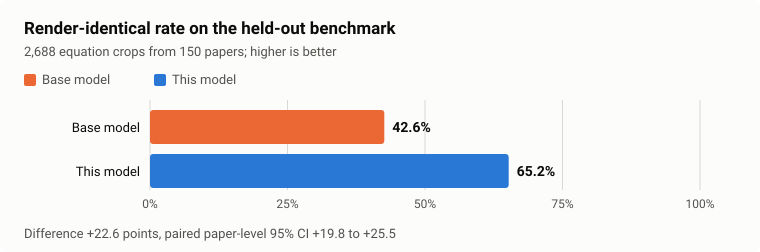
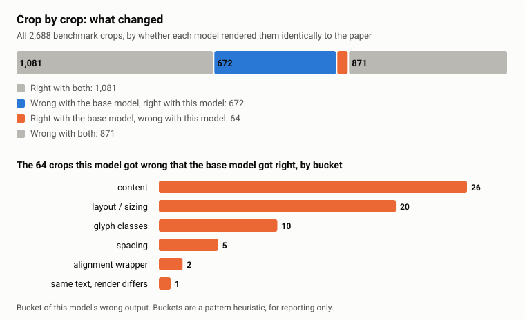
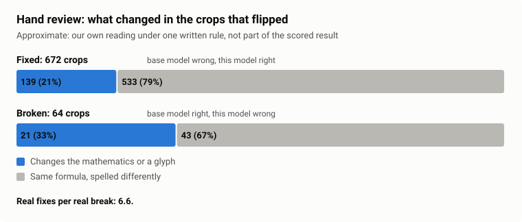

# glyphfix-math

A LoRA adapter for LightOnOCR-3-4B that makes fewer mistakes on mathematical notation, with the dataset and the benchmark it was trained and tested on. This repository is the code and the evidence: anyone can rescore the published results and rebuild the pipeline from it.

This is an independent project. It is not affiliated with, endorsed by, or sponsored by LightOn.

## What is where

| You want to | Go to |
|-------------|-------|
| Use the model (adapter and Q8_0 GGUF for Ollama or llama.cpp) | https://huggingface.co/ogaude/glyphfix-math-lora |
| Use the data: 8,000 training rows from 767 papers and a frozen held-out benchmark of 2,688 rows from 150 papers, built only from CC BY and CC0 arXiv papers (license checked per paper version as far as we could), every row with its paper's attribution | https://huggingface.co/datasets/ogaude/glyphfix-math-equations |
| Check the result: rescore the published predictions with the frozen scorer on CPU and Docker | [Reproduce](#reproduce) |
| Rebuild the pipeline from arXiv | [REBUILD.md](REBUILD.md) |
| See the numbers and the evidence | [Results](#results), [evidence/acceptance/ACCEPTANCE.md](evidence/acceptance/ACCEPTANCE.md) |

The errors that motivated the project are a prime read as the letter l or dropped, a Greek letter read as a Latin one (upsilon as v), decorations such as bold, bar and underline lost, and I read as 1. The status section says what the benchmark does and does not show for each.

## Why this project

Mathematical formulas are the part of a PDF where OCR mistakes cost the most. One wrong glyph, a prime read as the
letter l, a Greek letter read as a Latin one, a lost bold or bar, an I read as 1, can change which mathematical object
is meant, and a reader may not notice. We want OCR of formulas in PDFs to be as close to correct as we can get it.

This release is a first step. We work on images of single display equations because they are easy to measure,
and we score them by whether the output typesets to the same bitmap as the paper's LaTeX. We checked full pages only on
50 pages, and on full pages we have not shown an improvement yet (see Results below).

## Status: an initial release

This is our first release, and we want to be honest about what it is. The adapter scores higher than the base model on the frozen benchmark, with a paper-level confidence interval that excludes zero, and the benchmark has 39% fewer wrong crops (1543 down to 935), with 672 crops fixed for every 64 broken. About half of the drop in failures is in layout, spacing and alignment wrapper rows, which follow the conventions of the papers' own LaTeX and so count as gains for a reader who wants that match, but they are not the rare glyph classes that motivated the project. A broad group of errors is still not split into named classes. Of the classes that motivated the project, decorations show fewer errors, dropped primes show no significant change, and prime read as l, Greek read as Latin and I read as 1 have too few events in the benchmark to claim anything. The per-class table in the results shows each one. Treat the results as a starting point, not a finished product.







The last chart is our own approximate hand review of the crops that flipped, made under one written rule and not part of the scored result. About 21% of the 672 fixes (139) and about a third of the 64 breaks (21) change the mathematics or a glyph; the rest differ only in how the same formula is spelled. That is roughly 6.6 real fixes per real break, so most of the headline gain is the model matching the papers' LaTeX conventions.

Of the 1,543 crops the base model gets wrong on the benchmark, 935 remain wrong with the adapter. The largest remaining buckets are real content differences (304) and layout or sizing (236); the model card has the full six-bucket table, and `scripts/error_buckets.py` reproduces it. The buckets are a pattern heuristic for reporting, not part of the frozen scorer.

We want to build on it, with no date yet. The plan, which may change as we learn more:

- a training set built around each error class (primes, Greek letters, decorations, I against 1), so that these classes
  have enough events to measure
- possibly more training on the largest remaining buckets (layout / sizing, spacing, alignment wrappers, content),
  after we have read the `content` bucket more closely
- a new, separate benchmark, because the current one is frozen and its counts for the named classes are too small;
  any claim about the new training would need it
- a look at why the "same text, render differs" bucket grew
- more evidence on full pages, since that is the real target: a larger and separate set of pages, and a look at the
  unbalanced `$$` fences that cost this model equations on two test pages

Reports of equations the model gets wrong are welcome as issues on this repository.

Versions: this is project release v1.0.0 (see `VERSIONING.md`), with tags `lora-v1.0.0`, `dataset-v1.0.0` and `benchmark-v1`.

## Use the model

You do not need this repository to use the model. For Ollama:

```bash
hf download ogaude/glyphfix-math-lora --local-dir glyphfix-math-lora
cd glyphfix-math-lora
ollama create glyphfix-math-lora -f Modelfile
```

The model page has the full steps, including llama.cpp and PEFT: https://huggingface.co/ogaude/glyphfix-math-lora

## Results

The verdict below is our pre-registered rule applied to this one benchmark. It says the gain on these crops is unlikely to be chance. It does not say the model is better on other equations, and the page-level numbers further down are less certain.

Verdict: PASS. acceptance passed.

### Headline: render-identical on the benchmark crops

| | base model | this model | delta | 95% CI of delta | records | papers | McNemar p |
|---|---|---|---|---|---|---|---|
| render-identical | 42.6% | 65.2% | +0.2262 | [0.1983, 0.2546] | 2688 | 150 | 0.0000 |

Rule: pass if CI lower bound > 0, a paired bootstrap that resamples papers, not equations.

Paired outcomes: both right 1081, both wrong 871, right-to-wrong 64, wrong-to-right 672.

### Page-level transfer

| | base model | this model |
|---|---|---|
| render-identical on pages | 39.4% | 47.8% |
| equation match rate | 97.0% | 93.9% |
| normalized exact | 41.4% (32.0% to 50.5%) | 46.8% (37.9% to 55.3%) |
| spacing-insensitive render identical | 47.8% (37.9% to 57.4%) | 54.9% (44.8% to 64.8%) |

Paired delta +0.0842, 95% CI [-0.0104, 0.1773], 297 equations in 50 papers. Unmatched equations count as failures for both arms.

Transfer statement: page-level transfer holds.

The transfer result is reported beside the verdict and does not block it.

The equation match rate is the share of the reference display equations on the test pages that could be paired with an equation in the model's output. It says nothing about whether the LaTeX was right. An unmatched equation counts as a failure for both models in the page-level rate, so a lower match rate lowers the page-level score.

**Limits of these results**

- Page-level transfer holds under the pre-committed rule but is not a proven gain: the paired paper-level 95% CI is [-0.0104, 0.1773].
- On full pages this model matched 279 of 297 ground-truth equations against 288 for the base model. In the page outputs we analysed, almost all of the equations it lost sit on two pages where it left a `$$` fence unbalanced, so the extractor mispaired the rest of those pages (the equation text itself was present), and one more is a multi-line equation it wrote as three blocks; a few equations were gained. The metric depends on how each model fences and groups display equations.
- The classes prime_l, greek_latin, i_1 have too few base-model errors to claim a change.
- The dev gain (delta 0.2549) is in-sample because the checkpoint was selected on the dev split.
- Results are published exactly as scored by the frozen scorer 1.2.0.

Full report: [evidence/acceptance/ACCEPTANCE.md](evidence/acceptance/ACCEPTANCE.md). Index of every result file with its sha256: [results/README.md](results/README.md).

## Reproduce

Tier 1 rescores the published predictions with the frozen scorer on CPU and Docker and compares the outcome with the published `evidence/acceptance/results.json`. It needs [uv](https://docs.astral.sh/uv/) and Docker, and uses no GPU.

```bash
git clone https://github.com/ogaude/glyphfix-math.git
cd glyphfix-math
uv sync --frozen
docker pull texlive/texlive@sha256:0f4884ca7d287f47ab466d2dd405d4c901c576585363f628863a7ca7eea21301
uv run python -m scripts.release.reproduce
```

The command prints a verdict and writes a report. [REPRODUCE.md](REPRODUCE.md) explains each verdict and also documents Tier 2, the regeneration of predictions with Ollama.

## Hardware

The published model files and the benchmark rerun do not depend on a particular GPU: the GGUF is meant to run in Ollama or llama.cpp on any backend they support (we tested it with Ollama on ROCm, and with Ollama's bundled `llama-server` on CPU), and Tier 1 above uses no GPU. Training, export and the full rebuild were done and tested only on AMD ROCm (a gfx1200 card with 16 GB). The pinned training environment installs the ROCm build of PyTorch, so other GPUs need the matching PyTorch build and have not been tried. The resource guard also reads free VRAM through `nvidia-smi` and torch, but that path was tested only with mocked output, not on NVIDIA hardware.

## Rebuild

[REBUILD.md](REBUILD.md) lists the whole pipeline in script order: candidate harvesting, fetching, building and selecting equations, error mining, training, export and acceptance. The versions and digests it relies on are in [results/PINS.md](results/PINS.md). A rebuild re-derives the artifacts; the published benchmark stays the frozen one in `data/benchmark` and `data/splits`.

## Evidence

`evidence/acceptance/` holds the published `results.json`, `flips.jsonl`, `ACCEPTANCE.md`, `sensitivity.json` and `env_check.json` at the paths the frozen scorer reads, and `evidence/acceptance/FREEZE_AMENDMENT.json`. The latter is the record of the one change made to the frozen scorer after scoring: two path constants in `scripts/acceptance.py` moved from the development repository's planning folder (not published) to `evidence/acceptance/`. The change was approved, was proven to alter nothing else, and a cold rescore afterwards matched the published numbers. `evidence/acceptance/FREEZE_AMENDMENT_2.json` is the record of the rename made before the first release, in which the project, the Python package and our Ollama tags got their published names. The two frozen scoring files changed in names only, proven token by token from the git objects, and a cold rescore matched the published numbers.

`results/` holds the error-mining and development reports, `PINS.md` and an index of the result files whose rerun record cites the cold rescores in `evidence/acceptance/FREEZE_AMENDMENT.json` and `evidence/acceptance/FREEZE_AMENDMENT_2.json`.

The Python package was renamed from `lightonocr_math` to `glyphfix_math` before the first release; `FREEZE_AMENDMENT_2.json` records it.

## History

This history was filtered from the development repository to leave out unreleased data rows, so the commit hashes differ from those recorded inside `results.json`. `RELEASE_HISTORY.json` maps them. The reproduce command checks that mapping and both freeze amendments, which is why it reports `identical_modulo_history_and_amendment` rather than `identical`. Commits before the rename keep the old names because the published results were scored from them.

## Licenses

- Code: Apache-2.0 (see `LICENSE` and `NOTICE`). The charts under `results/charts/` are ours, also Apache-2.0.
- Model files (the adapter and the merged GGUF) on the model page: Apache-2.0. Its example images keep the license of their papers.
- Data rows: CC BY 4.0 or CC0 1.0 per record, as listed with authors and sources in `ATTRIBUTION.md` and `ATTRIBUTION.jsonl`.
- Our labels and annotations: CC BY 4.0.
- The base model LightOnOCR-3-4B is Apache-2.0, by LightOn.

## Disclaimer

This is an independent project. It is not affiliated with, endorsed by, or sponsored by LightOn.

## Contact and takedown

Open an issue on GitHub or write to ogaude.code+td@proton.me. If you are an author of a paper in the dataset and want a row removed, say which paper and we remove it.
